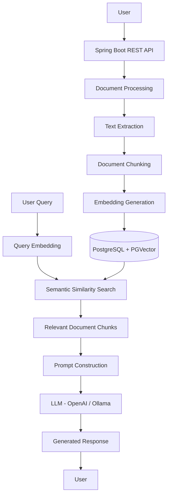

# 🧠 DocMind — AI-Powered Document Intelligence Platform

<p align="center">
  <strong>Chat with your documents. Retrieve knowledge. Get intelligent answers.</strong>
</p>

<p align="center">
  A Spring Boot and Spring AI-powered Retrieval-Augmented Generation (RAG) application designed to make document interaction smarter through Large Language Models and vector search.
</p>

<p align="center">
  
  
  
  
</p>

<p align="center">
  <a href="https://github.com/TOXIC2006/Docmind-01">Repository</a> •
  <a href="#-architecture">Architecture</a> •
  <a href="#-tech-stack">Tech Stack</a> •
  <a href="#-getting-started">Getting Started</a>
</p>

---

## 📌 Overview

**DocMind** is an AI-powered document intelligence application built using Java, Spring Boot, and Spring AI.

It explores how Retrieval-Augmented Generation (RAG) can connect private document knowledge with Large Language Models to generate context-aware responses.

Instead of relying entirely on an LLM's pre-trained knowledge, RAG retrieves relevant information from an external knowledge source and uses that context to generate more relevant answers.

The project focuses on building a modular backend architecture while exploring modern AI engineering concepts, including:

- Retrieval-Augmented Generation (RAG)
- Semantic Search and Vector Embeddings
- Vector Database Integration
- LLM Integration
- Document Processing
- Secure REST API Development

## ✨ Key Technologies & Capabilities

| Component | Technology |
|---|---|
| Backend | Java, Spring Boot |
| AI Framework | Spring AI |
| LLM Providers | OpenAI, Ollama |
| Vector Database | PostgreSQL + PGVector |
| ORM | Spring Data JPA |
| Document Processing | Apache Tika, PDF Reader |
| Security | Spring Security, JWT |
| API Documentation | SpringDoc OpenAPI |
| Build Tool | Maven |

## 🏗️ Architecture

DocMind follows a Retrieval-Augmented Generation architecture.



### 🔍 RAG Workflow

1. **Document Ingestion:** Documents are provided to the document processing pipeline.
2. **Text Extraction:** Extract textual information using document readers.
3. **Chunking:** Divide extracted content into smaller, manageable pieces.
4. **Embedding Generation:** Convert text chunks into numerical vector representations.
5. **Vector Storage:** Store embeddings in PostgreSQL using PGVector.
6. **Semantic Retrieval:** Convert user queries into embeddings and retrieve semantically similar content.
7. **Context Construction:** Prepare relevant retrieved information for the LLM.
8. **Response Generation:** Generate context-aware responses using the configured language model.

## 🛠️ Tech Stack

### Backend Development
- Java 17
- Spring Boot 3.4.11
- Spring Web
- Spring Data JPA
- Spring Security
- Maven

### Artificial Intelligence
- Spring AI 1.0.0
- OpenAI Model Integration
- Ollama Model Integration
- Retrieval-Augmented Generation
- Embedding Models

### Database & Storage
- PostgreSQL
- PGVector
- Vector Similarity Search

### Document Processing
- Apache Tika Document Reader
- Spring AI PDF Document Reader

### Security & API
- Spring Security
- JSON Web Token (JWT)
- SpringDoc OpenAPI / Swagger UI

## 🗄️ Database

DocMind uses PostgreSQL with the PGVector extension for vector storage and similarity search.

Vector databases allow document embeddings to be stored and searched based on semantic similarity rather than relying exclusively on exact keyword matching.

## 🚀 Getting Started

### Prerequisites

Make sure you have installed:

- Java 17+
- Maven
- PostgreSQL
- PGVector extension
- An OpenAI API key and/or Ollama installation

### 1. Clone the Repository

```bash
git clone https://github.com/TOXIC2006/Docmind-01.git
```

### 2. Navigate to the Project

```bash
cd Docmind-01
```

### 3. Configure Environment Variables

Configure your database credentials and AI provider settings in your Spring Boot configuration.

Example configuration values:

```properties
spring.datasource.url=jdbc:postgresql://localhost:5432/docmind
spring.datasource.username=your_username
spring.datasource.password=your_password

spring.ai.openai.api-key=${OPENAI_API_KEY}
```

Configure the remaining Spring AI and PGVector properties according to your selected model and application setup.

**Important:** Never commit API keys, database passwords, or other sensitive credentials to GitHub.

### 4. Run the Application

Using Maven:

```bash
mvn clean install
```

```bash
mvn spring-boot:run
```

### 5. API Documentation

Once the application is running, access Swagger UI:

```text
http://localhost:8080/swagger-ui/index.html
```

## 🎯 Learning Objectives

This project is also an exploration of modern backend and AI engineering.

Key concepts being explored:

- Understanding RAG architecture.
- Working with Spring AI abstractions.
- Understanding vector embeddings.
- Implementing semantic retrieval.
- Integrating LLM providers.
- Working with PostgreSQL and PGVector.
- Building secure backend APIs.
- Understanding document ingestion pipelines.

## 🔮 Future Enhancements

Potential improvements for the project:

- Hybrid Search (Semantic + BM25)
- Reciprocal Rank Fusion (RRF)
- Cross-Encoder Reranking
- Query Expansion and HyDE
- Redis-based Semantic Caching
- Conversation Memory
- Token Consumption Optimization
- Contextual Compression
- RAG Evaluation using RAGAS
- Docker-based Deployment
- Observability and Performance Monitoring

## 👨‍💻 Developer

**Siddharth Rawat**

Java Full-Stack Developer | Spring Boot | AI Engineering | RAG

- GitHub: [@TOXIC2006](https://github.com/TOXIC2006)
- Project: [DocMind](https://github.com/TOXIC2006/Docmind-01)

---

<p align="center">
  <strong>Building intelligent applications, one system at a time. 🚀</strong>
</p>
